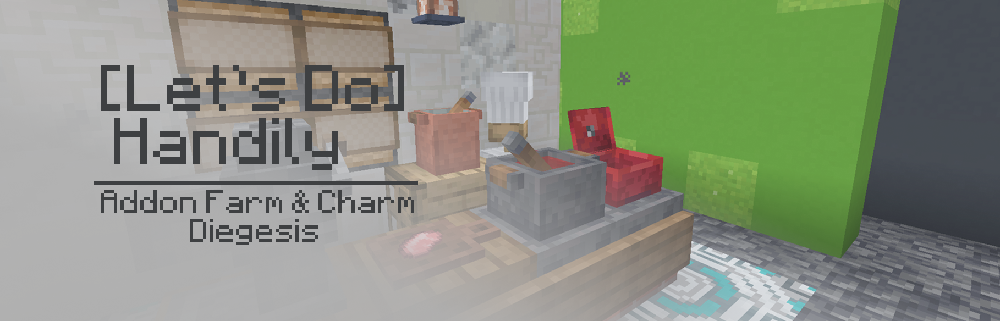
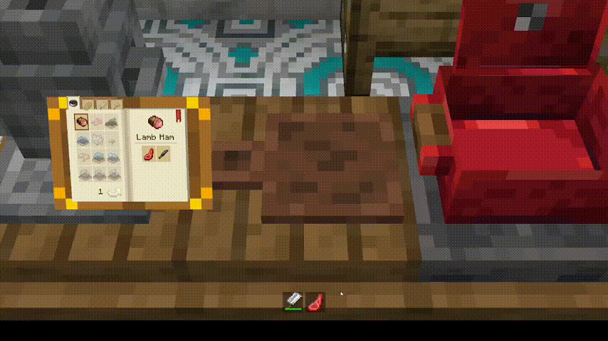
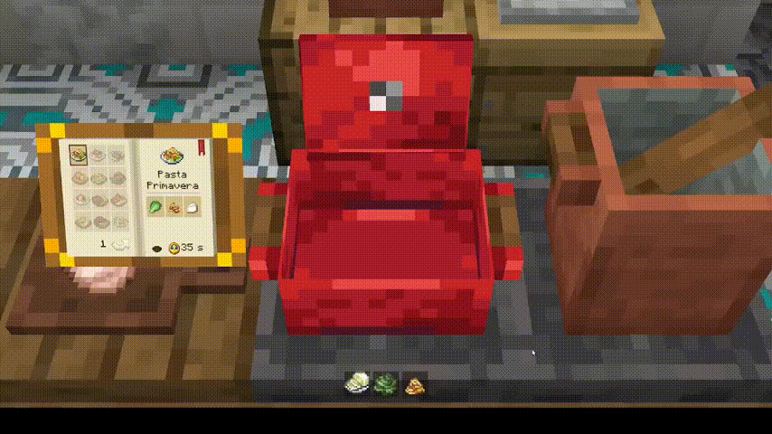
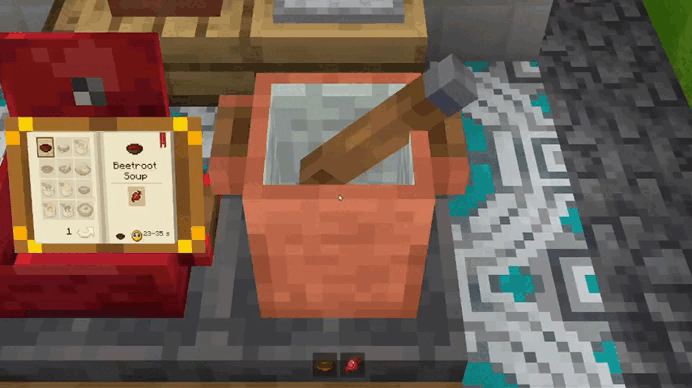

   

<em>Cook Farm &amp; Charm dishes with your own hands.</em>

The kitchen stays in the world: put food on the board, follow the cuts with your knife and stir the pot with its spoon. A cookbook beside the station shows the recipes and brings over missing ingredients from your inventory.

<h3 align="center" style="text-align:center">🔪 The cutting board</h3>

Lay down an ingredient and cut along the dashed marks. Queue up to sixteen of the same item; the last cut finishes the batch. Use a Farm &amp; Charm cleaver or a compatible knife.

Put a meal together on the same board: add the ingredients, then finish with the required bowl or plate. Right-click takes the top layer back.

<h3 align="center" style="text-align:center">🔥 The roaster</h3>

Lift the lid, lay out the food and close it over the heat. When it is ready, serve it with the matching bowl or plate. Click for one portion, Shift for a batch. Hoppers still work.

<h3 align="center" style="text-align:center">🕯 The rest of the kitchen</h3>

Stir soup in the cooking pot and mix ingredients with the bowl's whisk. With Candlelight, use its large pot and pan; with Bakery, cook jam and fill your jars. Each station keeps its original recipes. Mincers and HerbalBrews kettles keep their usual interactions.

<h3 align="center" style="text-align:center">Getting started</h3>

<strong>Minecraft 1.21.1 · NeoForge · Java 21</strong> Install Handily on the client and server with Farm &amp; Charm 1.1.29, Diegesis 1.0.0-beta.8 or beta.11, and Architectury API 13.0.11. Optional: Candlelight 2.1.15 · Bakery 2.1.11.

Right-click opens a station. Shift + right-click keeps its normal action. Esc returns to the world. Hands-On Delight and Farmer's Delight are not required.

<h3 align="center" style="text-align:center">Credits &amp; community</h3>

Inspired by <a href="https://modrinth.com/mod/handson-delight">Hands-On Delight</a> by Pocky. Built on Diegesis; adapted code is credited under MIT. The Let's Do mods belong to their authors. In development.

<a href="https://discord.gg/KxaDgrUm8P">Discord</a> · <a href="https://github.com/KenFlish/-Let-s-Do-Handily/issues">Bug reports</a> · <a href="https://github.com/KenFlish/-Let-s-Do-Handily">Source · MIT</a>

